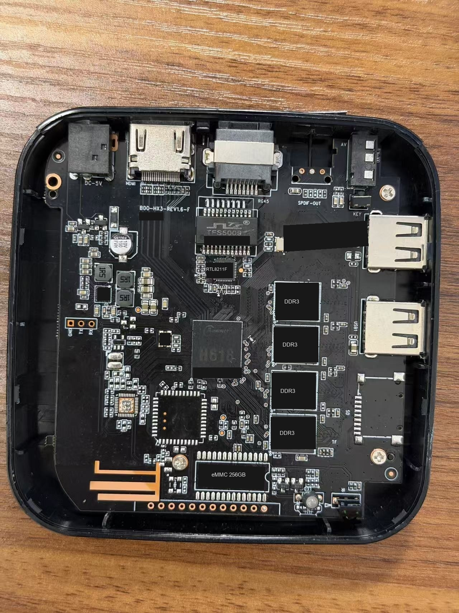

# H618 Armbian (Debian 12) USB Flash Image

[English](README.md) | [简体中文](README.zh-CN.md)

**Armbian based on Debian 12.15 Bookworm, running Linux 6.12.114.** Allwinner BSP eMMC HS400 driver logic has been ported and optimized for this H618 board, with **200MHz HS400** operation verified through read/write integrity and reboot tests. Flash directly to eMMC using **PhoenixUSBPro_V4.1.0**.

## Device and system

| Item | Specification |
|---|---|
| SoC | Allwinner H618, ARM64 |
| RAM / storage | **4GB DDR3 + 256GB eMMC** |
| Board | B00-HX3-REV1.6-F |
| Ethernet | **Realtek RTL8211F, Gigabit Ethernet** |
| OS | **Armbian based on Debian 12.15 Bookworm** |
| Kernel | **6.12.114-h618-hs400-r11i** |
| Storage driver | Linux 6.12.114 with ported and optimized Allwinner BSP HS400 logic |
| eMMC mode | **200MHz HS400, 8-bit, 1.8V**, automatic startup tuning |
| Disk layout | Automatic first-boot expansion; system and data share the root filesystem |
| TF slot | Not populated |
| Network | Automatic DHCP addressing |
| Initial login | User `root`, password `123456`; change it after logging in |
| Docker | Not preinstalled |

The 256GB configuration has been tested on hardware. The 128GB configuration still needs hardware validation. Check compatibility separately for other boards, revisions, and locked variants.

## Download

[Download the image and SHA256 checksums](https://github.com/niko188899/h618-armbian-phoenix-usb-flash/releases/tag/r11i-debian12).

File: **`H618-Armbian-USB-Flash.img.xz`**, approximately 574MB. Extract it to `.img` before flashing.

## Flashing

**Requirement: an early public-release box that can be unlocked and enters USB flashing mode by holding the reset button.**

1. Back up any data you need. Full-image flashing overwrites the existing system and data.
2. Open **PhoenixUSBPro_V4.1.0**, load the extracted `.img`, and start device detection/flashing mode.
3. Leave the box's **DC power adapter disconnected**. **Press and hold the reset button**, then connect the computer to the box's flashing USB port with a **USB-A to USB-A data cable**.
4. Release the reset button once the software detects the box and begins flashing. Wait for successful completion.
5. Disconnect the USB data cable, connect Ethernet, and then connect the DC power adapter to boot normally.
6. Allow first-boot expansion to finish. Find the assigned address in your router's DHCP list and log in through SSH.

Confirm the flashing USB port and reset-button location for your board.
